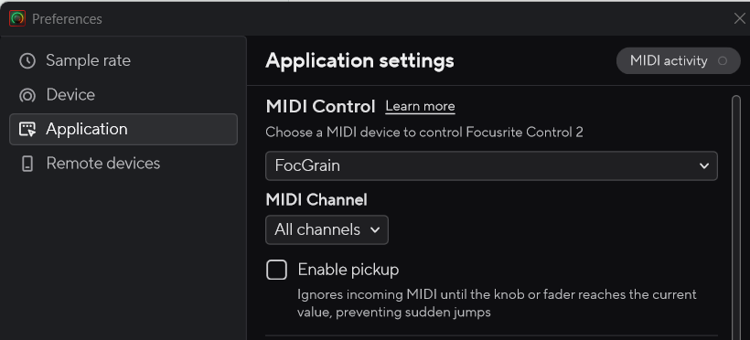
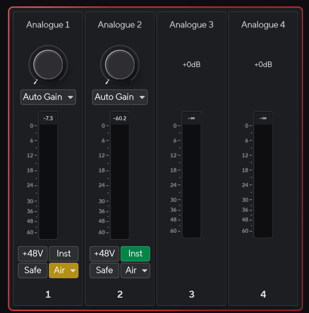

# Настройка Focusrite Control 2

[English](FC2_SETUP.en.md)

После установки FocGrain на последнем экране setup по умолчанию выбран **«Запустить FocGrain и мастер настройки FC2»**. Мастер можно открыть позже из меню трея, окна настроек или отдельного ярлыка меню «Пуск». Он не изменяет FC2 и не отправляет gain-команды автоматически.

1. Запустите FocGrain, затем Focusrite Control 2. В FC2 откройте **… → Preferences → Application**.
2. Выберите **MIDI Control → FocGrain**, **MIDI Channel → All channels** (или **1**).
3. **Снимите галочку Enable pickup**, как на снимке. Для мгновенного переключения MIN ↔ MAX она должна быть выключена.

Pickup ждёт совпадения MIDI-значения с текущим значением FC2 и до этого игнорирует управление. Для аппаратного регулятора это защита от скачка; для двух пресетов это может блокировать переключение. Пользователь подтвердил: после отключения pickup переключение gain заработало.

**Focusrite USB MIDI** — аппаратный MIDI-порт интерфейса, а не FocGrain. Его не нужно удалять. Выбирайте именно **FocGrain**, не тестовые QA-порты. Старые записи после диагностики могут оставаться в списке FC2: при необходимости закройте и откройте FC2 при запущенном FocGrain, не удаляя устройства Windows наугад.

4. В настройках FocGrain выберите **Analog 1 / Analog 2**, задайте свои минимум и максимум. Переключите пресет левой кнопкой по значку трея. Проверяйте **круглую ручку gain Analogue 1/2**, а не вертикальный индикатор уровня сигнала.

Числа над вертикальными метрами на снимке — уровень входного сигнала, не установленный gain. Значения пресетов **MIDI 0–127 не являются дБ**. Минимальный gain **не равен mute**. Начинайте проверку с выбранных вами безопасных уровней мониторинга.

Статус «Готов к управлению gain» означает, что FocGrain готов отправлять выбранные пресеты gain. Кнопка повторного открытия показывается только при неоткрытом порте; в рабочем состоянии нажимать «подключить» не требуется.

Названия элементов FC2 сохранены на английском для совпадения со снимками. Снимки предоставлены пользователем для этой инструкции; права на интерфейс и обозначения Focusrite принадлежат соответствующим правообладателям. Это независимый проект, не продукт Focusrite.

[Официальная MIDI-инструкция Focusrite](https://support.focusrite.com/hc/en-gb/articles/38789425032594-Controlling-Focusrite-Control-2-via-MIDI).

## После входа в Windows

С 1.0.3 оставьте в настройках FocGrain включённым «Запускать FC2 после готовности MIDI-порта». Порядок: запуск FocGrain → готовность WinMM-входа → запуск FC2. Уже работающий FC2 повторно не запускается. Focusrite Notifier не заменяет FC2. Если опция выключена, FC2 нужно открыть вручную.
